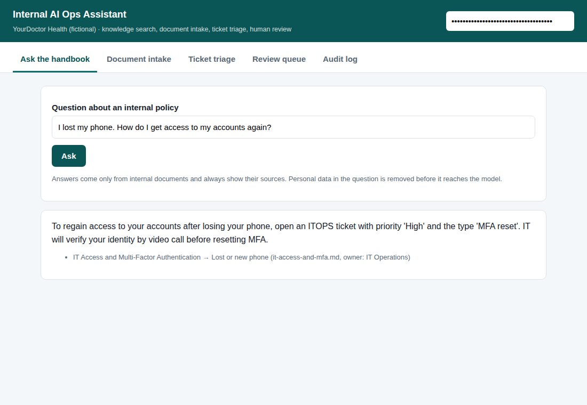
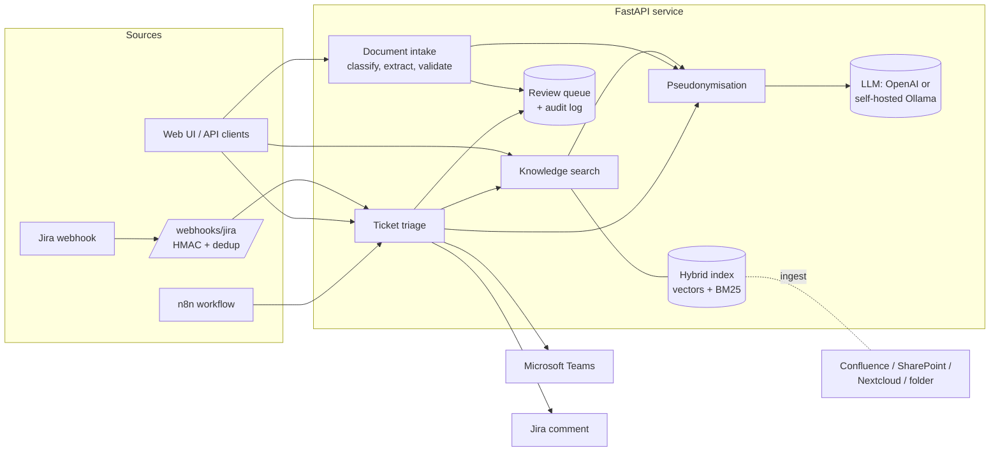
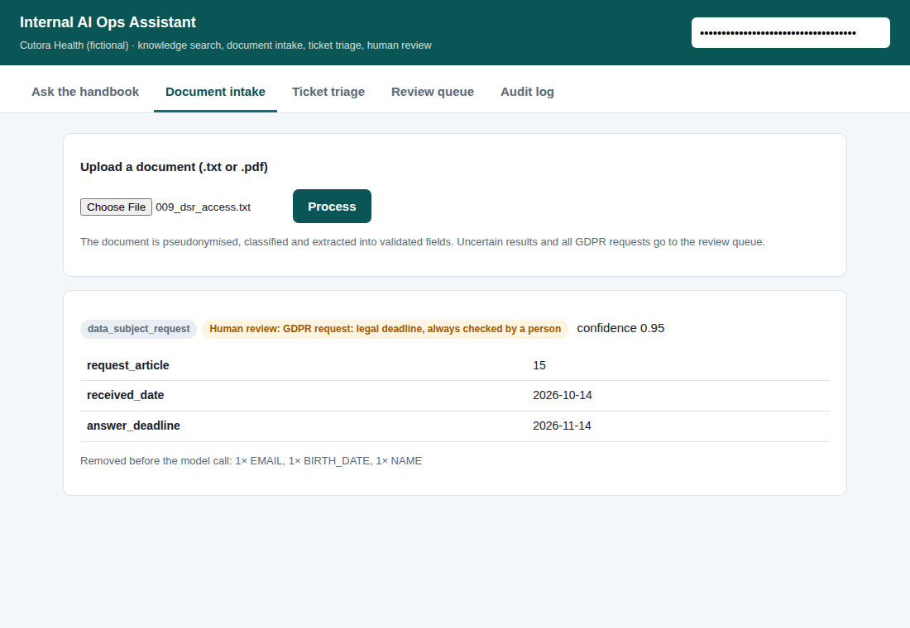
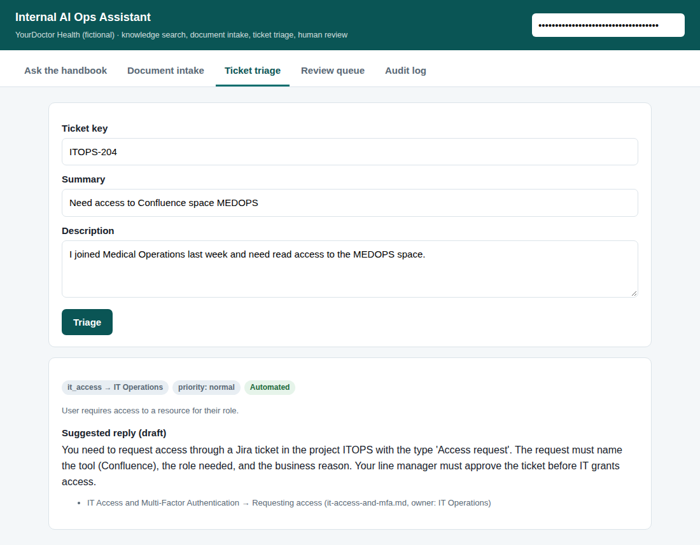
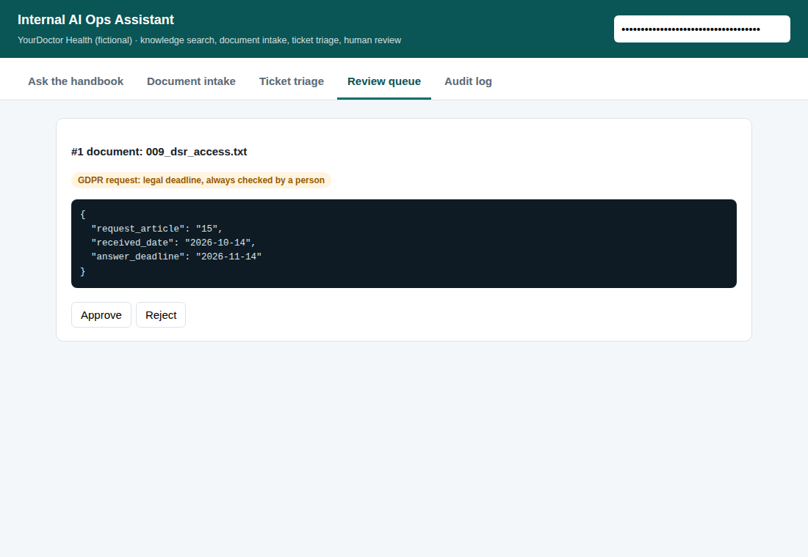

# Internal AI Ops Assistant

[](https://github.com/sayamrina/ai-ops-assistant/actions/workflows/ci.yml)

**Project 2026** · [Live demo](https://ops-assistant.streamlit.app/) · [Project page](https://sayamrina.github.io/ai-ops-assistant/) · [Portfolio](https://sayamrina.github.io/)

An internal AI service for a (fictional) telemedicine company, **Cutora Health**. It helps teams with three everyday operational problems and keeps a human in control wherever data or decisions are sensitive:

1. **Knowledge search**: employees ask questions about internal policies and get short answers with the exact source, or an honest "not in the documents".
2. **Document intake**: incoming emails, invoices, doctor applications and GDPR requests are classified and turned into validated, structured data.
3. **Ticket triage**: new Jira tickets arrive by webhook, get a category, priority and team, plus a reply draft from the knowledge base, and are routed to Microsoft Teams.



## Design principles

| Principle | How it is implemented |
|---|---|
| **Privacy by design (GDPR)** | Emails, phone numbers, IBANs, insurance numbers, birth dates and names are replaced by placeholders **before** any text reaches a model ([`app/privacy.py`](app/privacy.py)). Logs contain IDs and outcomes, never document text. The model can run self-hosted with Ollama, so no data has to leave the company. |
| **Human review** | Low confidence, failed validation, every GDPR request and every security or data protection ticket go to a review queue. Reviewers approve, correct or reject; nothing sensitive is sent automatically. |
| **Grounded answers** | The assistant answers only from retrieved documents, must cite them, and citations the model invents are discarded. Without a relevant document it refuses instead of guessing. |
| **Rules in code, not in the prompt** | Legal deadlines (one month for GDPR requests), missing documents and field formats are computed and validated in Python with Pydantic, not left to the model. |
| **Secure integration** | Role-based API keys (stored only as SHA-256 hashes), HMAC-signed webhooks, deduplication of webhook retries, secrets only from environment variables, timeouts and retries with backoff for every external call. |
| **Operable** | Structured JSON logs with request IDs, Prometheus metrics (requests, latency, LLM calls, pipeline outcomes), `/health` and `/ready`, audit trail of every AI decision and human review. |

## Architecture



## Evaluation

Measured with `gpt-4o-mini` and `text-embedding-3-small` on the labelled sets in [`data/eval`](data/eval) (run `python -m eval.run_eval`):

| Pipeline | Metric | Result |
|---|---|---|
| Knowledge search | Right document in top 1 / top 3 (18 questions) | 94% / 100% |
| Knowledge search | Answered and cited the right document | 100% |
| Knowledge search | Refused questions outside the documents (2) | 100% |
| Document intake | Document type correct (12 documents) | 100% |
| Document intake | Extracted fields correct (44 fields) | 100% |
| Document intake | Sent to human review | 3 of 12 (all GDPR requests) |
| Ticket triage | Category / priority correct (8 tickets) | 100% / 100% |
| Ticket triage | All sensitive tickets routed to a human | yes |

**Read these numbers with care.** The sets are small and self-made. The first run scored 83% on cited answers and 98% on fields; the answer prompt was then adjusted once (it refused yes/no questions such as "Can I get MFA codes by SMS?") and the vendor field rule was clarified. A real deployment needs a larger evaluation set written with the teams that use the tool, and the evaluation should run in CI on every prompt change.

## Screenshots

| Document intake: GDPR request | Ticket triage | Review queue |
|---|---|---|
|  |  |  |

## API

| Endpoint | Role | Purpose |
|---|---|---|
| `POST /api/ask` | viewer | Question → answer with sources |
| `POST /api/documents` | operator | Upload .txt or .pdf → type, fields, review decision |
| `POST /api/triage` | operator | Ticket → category, team, priority, reply draft; optional Teams/Jira delivery |
| `POST /webhooks/jira` | HMAC signature | Jira Cloud `issue_created` webhook |
| `GET /api/review`, `POST /api/review/{id}` | reviewer | Review queue: approve, correct or reject |
| `GET /api/review/audit` | admin | Audit trail |
| `GET /health`, `/ready`, `/metrics` | none | Operations |

Interactive documentation is available at `/docs` (OpenAPI).

## Integrations

- **Sources for the knowledge base:** local folder, Confluence Cloud (REST v2, with pagination), SharePoint (Microsoft Graph), Nextcloud (WebDAV): [`app/connectors/sources.py`](app/connectors/sources.py)
- **Outputs:** Microsoft Teams (Adaptive Card via Workflows webhook), Jira Cloud comments (Atlassian Document Format): [`app/connectors/notify.py`](app/connectors/notify.py). Without configuration they run in dry-run mode.
- **Low-code:** an [n8n workflow](integrations/n8n-jira-triage.json) that calls the triage API and routes tickets by `needs_review`.

The connectors are tested against mocked HTTP responses that follow the vendors' API documentation; they have not been run against a live company tenant.

## Run it

```bash
python -m venv .venv && . .venv/bin/activate
pip install -r requirements-dev.txt
cp .env.example .env                   # choose OPS_LLM_PROVIDER and add your key
python -m app.cli create-key amrina admin   # prints a key and the line for OPS_API_KEYS
python -m app.cli ingest
uvicorn app.main:app --reload          # http://localhost:8000
```

With Docker: `docker compose up`, or `docker compose --profile local-llm up` to run the model with Ollama on the same machine.

Tests run offline with a deterministic fake model (no API key needed): `ruff check . && pytest` (23 tests, 86% coverage). GitHub Actions runs lint (including security rules), tests and a Docker build on every push.

## What I would add for production

- A NER-based pseudonymiser (for example Microsoft Presidio) in addition to the rules, plus regular tests with real (consented) samples.
- Single sign-on with Microsoft Entra ID instead of API keys, and secrets from a vault.
- PostgreSQL with pgvector instead of SQLite and the in-memory index; OpenTelemetry tracing.
- Prompt and model changes gated by the evaluation in CI, with results stored over time.
- A data processing agreement check before any external model is enabled.

## Notes

Cutora Health and all documents, people and numbers in this repository are fictional. This app was built by Amrina, with AI as a supporting tool for coding.
